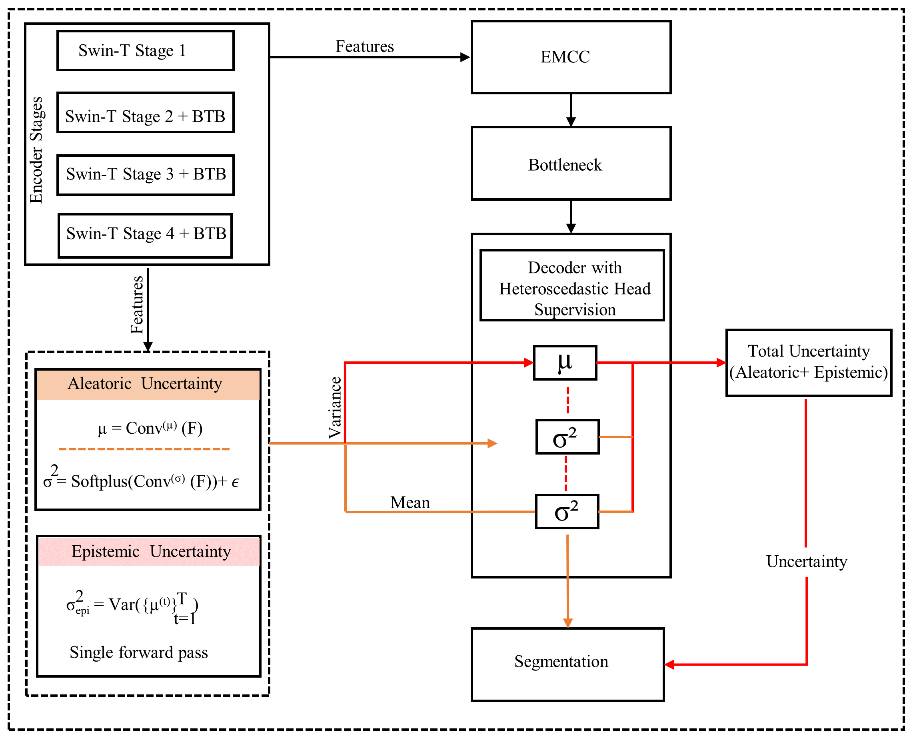
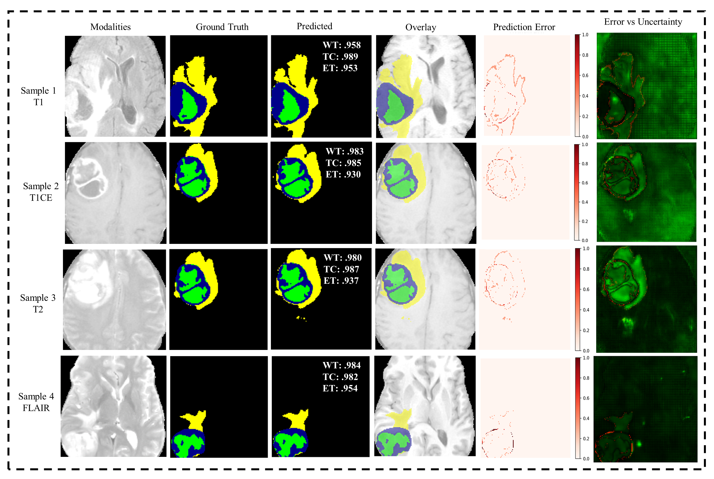
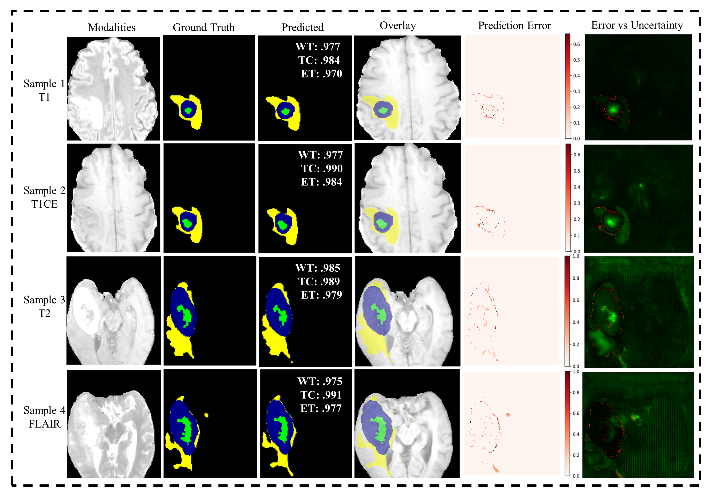

<div align="center">

# MSUQ-Net

### Uncertainty-aware brain tumor segmentation from multimodal MRI

**PyTorch · Swin Transformers · Bayesian learning · BraTS**

[Overview](#overview) · [Architecture](#architecture) · [Visual results](#visual-results) · [Repository guide](#repository-guide) · [Workflow](#workflow)

</div>

## Overview

MSUQ-Net is a research project for segmenting brain tumors from multimodal MRI while estimating prediction uncertainty. The supplied implementation combines Swin Transformer feature extraction, Bayesian transition blocks, EMCC convolutional blocks, a decoder with skip connections, and heteroscedastic prediction heads.

The network processes **2D axial slices** with four MRI channels in the order **FLAIR, T1, T1CE, T2**. It predicts three overlapping tumor regions:

- **WT — Whole tumor:** BraTS labels 1, 2, and 4.
- **TC — Tumor core:** BraTS labels 1 and 4.
- **ET — Enhancing tumor:** BraTS label 4.

The project also includes patient-level data preparation, training, 2D evaluation, reconstruction and evaluation of complete 3D patient volumes, and a conservative cross-release overlap audit.

## Architecture

### Overall network


[Open the full-resolution network diagram](main%20diagram%20%281%29.png).

The model is implemented as `BayesianEMCCUncertaintyModel` in [`model.py`](model.py). Its outputs include final segmentation mean logits, predicted variance, decoder logits, and auxiliary mean/variance predictions at encoder scales.

### EMCC and Bayesian transition blocks


The supplied figure details the Bayesian transition block (BTB) in panel (a) and the EMCC convolutional block in panel (b).

[Open the full-resolution EMCC and BTB diagram](EMCC%20%26%20BTB%20Block%20.png).

### Uncertainty estimation



[Open the full-resolution uncertainty diagram](uncertainity.png).

**Uncertainty estimation:** the 2D evaluator averages sigmoid probabilities over repeated Bayesian weight samples, estimates epistemic uncertainty from the sample variance of logits, and estimates aleatoric uncertainty from the mean predicted variance. Ordinary dropout remains disabled during this evaluation.

## Visual results

The figures below are the original images supplied with this project. They show MRI examples, ground-truth masks, predicted masks, overlays, prediction error, and error-versus-uncertainty visualizations.

### BraTS 2020 examples



[Open the full-resolution BraTS 2020 figure](Figures-test-2020.png).

### BraTS 2021 examples



[Open the full-resolution BraTS 2021 figure](Figures2021.png).

The annotations in these supplied figures describe the displayed examples. They are not a newly reproduced evaluation or a dataset-wide performance summary. Trained checkpoints, experiment logs, and raw datasets are not included in this repository.

## Repository guide

```text
MSUQ-NET-/
├── model.py                              # Network architecture and uncertainty heads
├── dataset.py                            # NumPy slice loader and WT/TC/ET targets
├── data_progress.py                      # Patient-level preprocessing and split manifests
├── training_script.py                    # Training, validation, checkpoints, and plots
├── losses.py                             # Segmentation loss implementations
├── metrics.py                            # Segmentation and distance metrics
├── MSUQ_Net_test_2d_final.py               # 2D segmentation and uncertainty evaluation
├── test_3D_reconstruction.py              # Patient-level 3D reconstruction and metrics
├── reverse_overlap_audit.py               # Cross-release exact-slice overlap screening
├── cross_dataset_evaluation.py            # Evaluation after candidate exclusions
├── Datasets Link.txt                     # Original dataset URL notes
├── Figures-test-2020.png                  # Supplied BraTS 2020 figure
├── Figures2021.png                        # Supplied BraTS 2021 figure
├── main diagram (1).png                   # Overall network architecture
├── EMCC & BTB Block .png                  # EMCC and Bayesian transition block details
├── uncertainity.png                      # Supplied uncertainty schematic
└── README.md
```

## Data

Dataset links supplied with the project:

- [BraTS 2020 training and validation data on Kaggle](https://www.kaggle.com/datasets/awsaf49/brats20-dataset-training-validation)
- [BraTS 2021 Task 1 data on Kaggle](https://www.kaggle.com/datasets/dschettler8845/brats-2021-task1/data)
- [BraTS 2024 dataset — full tumor-centered cropped data on Kaggle](https://www.kaggle.com/datasets/muhammadwahajsajid/brats-2024-dataset-full-tumor-centered-cropped)

The preprocessing script expects one directory per patient, containing matching NIfTI files:

```text
BraTS_Training_Data/
└── <patient_id>/
    ├── <patient_id>_flair.nii.gz
    ├── <patient_id>_t1.nii.gz
    ├── <patient_id>_t1ce.nii.gz
    ├── <patient_id>_t2.nii.gz
    └── <patient_id>_seg.nii.gz
```

Uncompressed `.nii` files are also supported. Filenames and segmentation labels must match the conventions configured in `data_progress.py` and `dataset.py`.

## Environment

The source imports the following third-party packages:

```text
torch
torchvision
numpy
scipy
scikit-learn
scikit-image
opencv-python
SimpleITK
matplotlib
seaborn
tqdm
timm
blitz-bayesian-pytorch
```

`openpyxl` enables the overlap audit's optional Excel report. `medpy` is an optional metrics dependency. The optional `LovaszHingeLoss` implementation requires the separately available `LovaszSoftmax.pytorch.lovasz_losses` module.

Training calls CUDA directly and therefore requires a compatible NVIDIA GPU and PyTorch installation. Evaluation scripts expose a device option and can select CPU when CUDA is unavailable. Dependency versions and a tested environment lockfile were not supplied.

## Workflow

1. **Prepare the MRI data.** Download the dataset separately and arrange patient folders using the expected filenames.
2. **Preprocess at patient level.** `data_progress.py` defaults to a seeded 60% / 20% / 20% train, validation, and test split, with a 160 × 160 in-plane crop. Training and validation retain tumor-containing slices; testing retains every slice and complete patient-volume metadata.
3. **Train the model.** `training_script.py` uses the prepared train and validation folders, checks patient overlap, and writes checkpoints, training history, and plots.
4. **Evaluate 2D predictions.** `MSUQ_Net_test_2d_final.py` supports Monte Carlo sampling, segmentation metrics, uncertainty analysis, and saved visualizations.
5. **Reconstruct and evaluate 3D volumes.** `test_3D_reconstruction.py` predicts axial slices, restores their original in-plane dimensions, and calculates patient-level region metrics. The network itself remains 2D.
6. **Screen cross-release overlap when relevant.** `reverse_overlap_audit.py` compares BraTS 2021 training/validation slices against BraTS 2020 test volumes. `cross_dataset_evaluation.py` evaluates the retained cohort after excluding strong screening candidates.

Preprocessing produces the following structure:

```text
processed_data/
├── trainImage/                  # Paired .npy slices
├── trainMask/
├── valImage/
├── valMask/
├── testImage/                   # Every held-out axial slice
├── testMask/
├── testVolumes/                 # Patient .npz volumes and reconstruction metadata
└── manifests/
    └── patient_split.json
```

### Source snapshot notes

The Python scripts are published exactly as supplied. Several entry points import `models.model`, while this snapshot contains `model.py` at the repository root. A matching package layout is needed before those entry points can run. Some comments also refer to earlier script names. This upload does not include source fixes or claim a verified end-to-end run.

Use a checkpoint trained with the same architecture, modality order, preprocessing, and patient split. A disjoint split manifest alone does not establish the training provenance of an existing checkpoint. Exact-slice overlap candidates are a screening result; excluding them does not prove that the remaining cross-release cohort is independent.

## Research context

This repository provides research code and supplied qualitative figures. It does not include a publication citation or an independently reproduced benchmark. Dataset access and reuse remain subject to the respective providers' terms.
